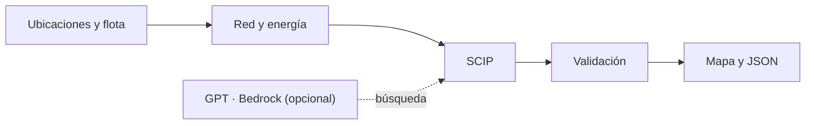

<picture>
  <source media="(prefers-color-scheme: dark)" srcset="webapp/assets/brand/svg/logo-inverse.svg">
  
</picture>

# Planificación de rutas para vehículos eléctricos

ZMD Mobility planifica entregas y recargas de una flota eléctrica. Primero busca
atender la mayor cantidad de clientes; después, reducir el consumo neto de batería.
Cada ruta debe respetar la batería disponible y regresar al depósito.

Proyecto para la hackatón AWS Breaking Barriers Chile 2026, en el desafío de CASE,
Centro de Aceleración Sostenible de Electromovilidad de la FCFM de la Universidad
de Chile. El caso oficial usa dos Nissan Leaf 2013 al 60 % de carga inicial.
Las ubicaciones del dataset están en Ann Arbor, Michigan.

## Empezar

Requiere Python 3.12 o 3.13 y `uv`. Desde la raíz del repositorio:

```bash
uv sync --locked --extra dw
uv run --locked --extra dw python -m backend.local_server --port 4294
```

Abre `http://127.0.0.1:4294/` y pulsa **Cargar y calcular**. Para resolver sin
AWS, elige **Estándar** en el campo **Búsqueda**.

La interfaz usa HTML, CSS y JavaScript, sin compilación adicional. El servidor
Python atiende la web y ejecuta el mismo motor que la línea de comandos.

### Correr el caso de la hackatón

El caso histórico necesita estos archivos locales, distribuidos por separado:

```text
data/competition_routing_nodes.csv
data/eVED_EV.csv
artifacts/network/competition_delivery.graphml
```

El CSV contiene el depósito, 20 clientes y 60 cargadores. eVED aporta mediciones
históricas de consumo eléctrico; el GraphML contiene las calles y sus sentidos de
circulación. El servidor detecta esa red automáticamente. Para usar otra, indica
`--graphml RUTA` y el `--network-profile` correspondiente al arrancar.

Si tienes los CSV y falta la red, puedes prepararla con:

```bash
bash scripts/prepare_hackathon.sh config/default.json
```

Este paso descarga la red cuando falta, integra el histórico y guarda la instancia
vial en `artifacts/hackathon/`. Los originales se conservan.

En la app:

1. En **Cargar y calcular**, selecciona **Cargar caso histórico**. Se cargan las
   ubicaciones y el histórico eléctrico desde el servidor.
2. Revisa **Flota y supuestos** y mantén **Calles del servidor** como red.
   La capacidad útil de 24 kWh, la reserva de 2,4 kWh y el consumo de respaldo de
   0,2 kWh/km son valores editables del ejemplo.
3. Elige la búsqueda y su presupuesto; pulsa **Calcular rutas**.
4. Consulta los recorridos, paradas, recargas y batería en **Plan**.
   **Ver resultados** permite revisar las comprobaciones y descargar la ejecución
   completa o el resultado nativo en JSON.

**Simular una variante de este caso** permite cambiar la cantidad de clientes y
cargadores sobre la misma red, conservando el depósito y el histórico. La semilla
permite repetir las ubicaciones generadas. La interfaz admite hasta 200 ubicaciones
en total; los puntos añadidos son simulados.

También puedes cargar tus ubicaciones en CSV, importar una instancia JSON o usar
**Crear un caso de prueba por distancia** para probar la app sin los datos
históricos. Ese caso usa conexiones sintéticas. El ejemplo de diseño de Inicio
contiene valores ilustrativos y se identifica por separado de una ejecución.

### Probar el motor desde la terminal

Este ejemplo incluido en el repositorio ejecuta SCIP sin AWS ni datos externos:

```bash
uv run --locked --extra dw ev-routing run \
  --instance examples/toy_recharge.json \
  --solver scip-routes --search-policy standard \
  --time-limit-seconds 30 \
  --output artifacts/toy-result.json
```

Para resolver el caso completo después de prepararlo:

```bash
bash scripts/run_pptx.sh 120
```

El resultado queda en `artifacts/hackathon/service-result.json`, junto con los
logs de preparación y resolución.

## Cómo funciona



La app y la CLI convierten sus entradas al mismo contrato `ProblemInstance`.
El backend prepara la red dirigida y estima el consumo a partir del histórico
disponible y los supuestos configurados. La cobertura de esa calibración queda
registrada; donde falta evidencia se usa el consumo de respaldo.

El motor predeterminado, `scip-routes`, selecciona rutas completas con SCIP y
PySCIPOpt, sin un máximo artificial de movimientos. Conserva recargas parciales,
visitas repetidas a cargadores y regeneración cuando la instancia la representa.
El preprocesamiento mantiene los caminos y perfiles necesarios para comprobar
la batería a lo largo del recorrido.

Después de resolver, un validador independiente comprueba continuidad, entregas
únicas, retorno y límites de batería. En el caso vial, expande las rutas sobre
las calles originales. El JSON conserva los supuestos, tiempos, cotas y estado
de cada fase. La formulación está en [modelamiento.pdf](modelamiento.pdf);
la referencia posicional en Pyomo sigue disponible como backend explícito.

## GPT y AWS Bedrock

La búsqueda **GPT rápido · Bedrock** consulta el modelo antes y durante la
resolución para ajustar estrategias y parámetros admitidos del solver.
La física, los objetivos y los criterios de certificación permanecen a cargo
del motor. Las solicitudes, respuestas y cambios aplicados quedan registrados.
Ante un fallo de AWS, continúa la política local y se registra el fallo.

Para usar el perfil AWS del proyecto, arranca el servidor con:

```bash
AWS_PROFILE=hackathon uv run --locked --extra dw python -m backend.local_server \
  --port 4294 --tee
```

El perfil debe tener acceso a Bedrock. La región inicial es `us-east-1` y el
modelo es `us.openai.gpt-5.6-luna`, con razonamiento `low`. Se pueden configurar
mediante `AWS_DEFAULT_REGION` y `BEDROCK_MODEL_ID`. Las credenciales permanecen
fuera del repositorio.

El botón **Asistente** permite configurar y calcular mediante conversación.
Sus peticiones pasan por el mismo pipeline de preparación y resolución.
La [guía de integración](docs/webapp-integration.md) detalla la conexión y los
presupuestos; la [guía del chat](docs/assist/chat_web.md) explica su uso.

## Interpretar los resultados

La validación acredita factibilidad respecto de la red, el consumo estimado y
los supuestos de esa ejecución. El consumo histórico es una referencia para el
modelo; su precisión sobre viajes futuros requiere validación adicional.

El solver informa por separado entregas y energía, con sus soluciones, cotas y
condiciones de término. El gap energético predeterminado de 0,5 % es una tolerancia.
La prueba de óptimo exacto exige cerrar la brecha. Si se agota el presupuesto, se
conserva la solución factible encontrada y se indica qué quedó sin demostrar.

Los [benchmarks recientes de 200, 400 y 800 clientes](docs/benchmarks/2026-10-16-scale/README.md)
comparan búsqueda estándar y adaptativa sobre instancias sintéticas, con métricas,
validaciones y llamadas reales a Bedrock. La
[campaña anterior](docs/benchmark-results-2026-10-16.md) se documenta por separado.

## Desarrollo y documentación

Las pruebas habituales se ejecutan sin llamadas a AWS ni descargas de mapas:

```bash
uv run --locked --extra dw python -m pytest -q
node --test webapp/tests/*.test.mjs
uv run --locked ruff check src tests
```

| Referencia | Contenido |
| --- | --- |
| [Interfaz y servidor](docs/webapp-integration.md) | Puesta en marcha, datos locales, conexión AWS y exportaciones. |
| [Modelo y solver](docs/dantzig-wolfe.md) | Formulación por rutas, pricing y alcance de los certificados. |
| [Preprocesamiento](docs/resource-paths.md) | Caminos, perfiles de batería, caché y garantías. |
| [Supuestos operacionales](docs/operations.md) | Jornada, ventanas, recargas y márgenes de consumo. |
| [Contratos HTTP](backend/API_CONTRACT.md) | Entradas y salidas de la API. |
| [Datos eVED](diccionario.md) | Campos, unidades y advertencias de los históricos. |
| [Estructura del proyecto](STRUCTURE.md) | Módulos y responsabilidades. |

Los datos originales, las redes grandes, las cachés y las credenciales se
mantienen fuera de Git. Las ejecuciones locales se guardan en `artifacts/`.
